# 训练记录与分析

梅花桩任务（`Robot-StepStone-v0`）两轮长训练的曲线解读、行为分析和对应的奖励改动记录。
截图都在 [`assets/images/`](../assets/images/)，每次训练一个以启动时间命名的子目录。

| 轮次 | 运行目录 | 迭代 | 结果 | 视频 |
| --- | --- | --- | --- | --- |
| 第 1 轮 | `2026-10-26_22-26-00` | 500 | 课程全通，但**高速飞越**（覆盖率 0.43） | [stepstone_demo.mp4](../assets/videos/2026-10-26_22-26-00/stepstone_demo.mp4) |
| 第 2 轮 | `2026-10-27_07-56-35` | 500 → 600 | 覆盖率爬到 0.85，但**末期趴在桩上磨时间** | 600 迭代：[stepstone_demo_600.mp4](../assets/videos/2026-10-27_07-56-35/stepstone_demo_600.mp4)<br>500 迭代（切换前）：`assets/videos/2026-10-27_07-56-35/stepstone_demo_500.mp4`（待补录） |

---

## 第 1 轮：2026-10-26_22-26-00（500 迭代）—— 高速飞越

对应奖励：`c64bb45` **之前**的版本（终点奖励与覆盖率无关，进度奖励无上限）。

| 曲线 | 读法 |
| --- | --- |
| 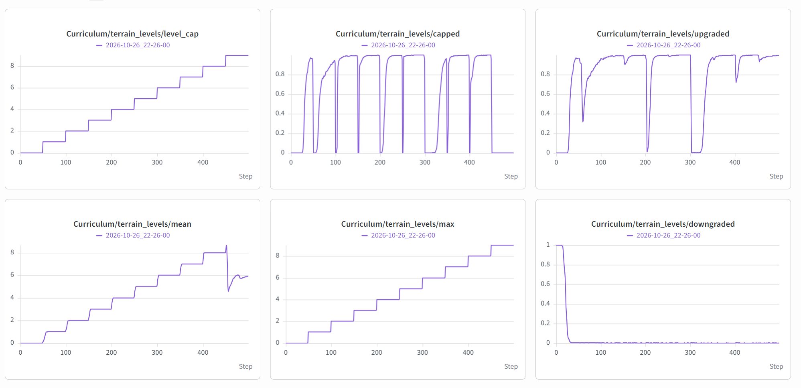<br>**地形课程** | `level_cap` 每约 50 迭代线性放行一级；`mean/max` 最终到 9；`downgraded` 在 50 迭代后归零，说明不再需要降级 |
| 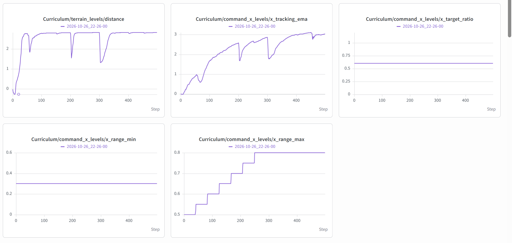<br>**速度指令课程** | `distance` 稳定在 2.8（= 终点距离）；`x_tracking_ema` 一路涨到 3.0 —— **这是异常值**，说明它测的是"实际速度"而不是"跟踪率"（已在 `bc47895` 修正）；`x_range_max` 因此被打满到 0.8 |
| 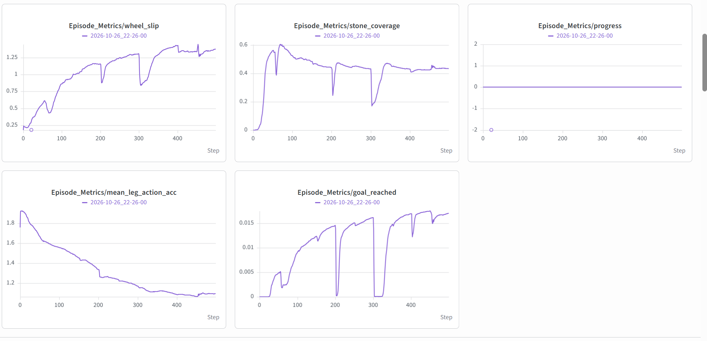<br>**任务指标** | `stone_coverage` 只有 **0.43** —— 近一半的桩没踩到；`wheel_slip` 涨到 1.3（空转严重）；`mean_leg_action_acc` 从 1.8 降到 1.1 |
| 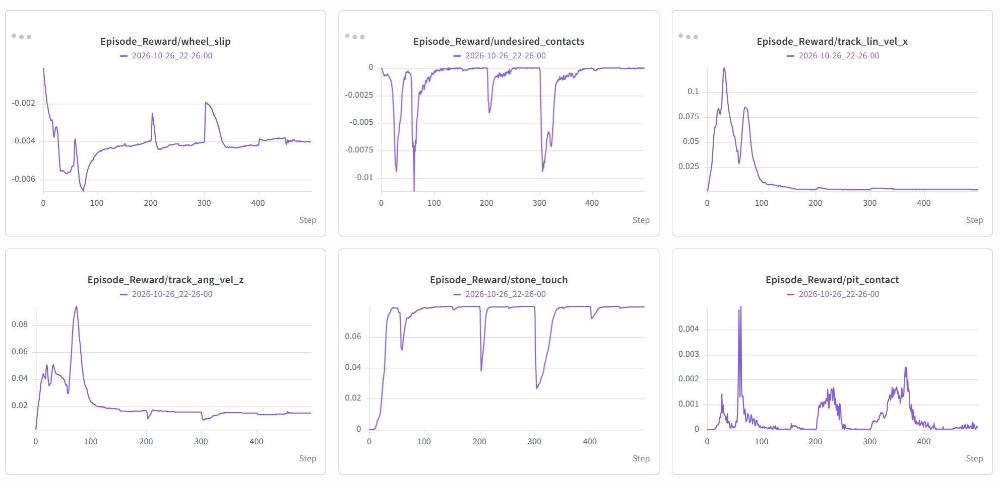<br>**奖励项（一）** | `track_lin_vel_x` 在 100 迭代后掉到 ~0 —— 不再跟速度指令；`stone_touch` 稳定在 0.07 左右（被"飞越"稀释） |
| 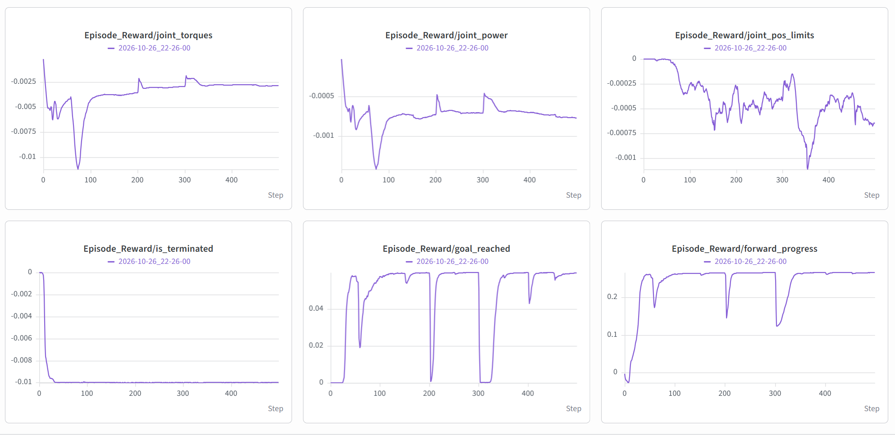<br>**奖励项（二）** | `forward_progress` 爬到 0.25 后走平；`goal_reached` 稳定在 0.05（频繁成功）；`is_terminated` 稳定在 −0.01 |
| 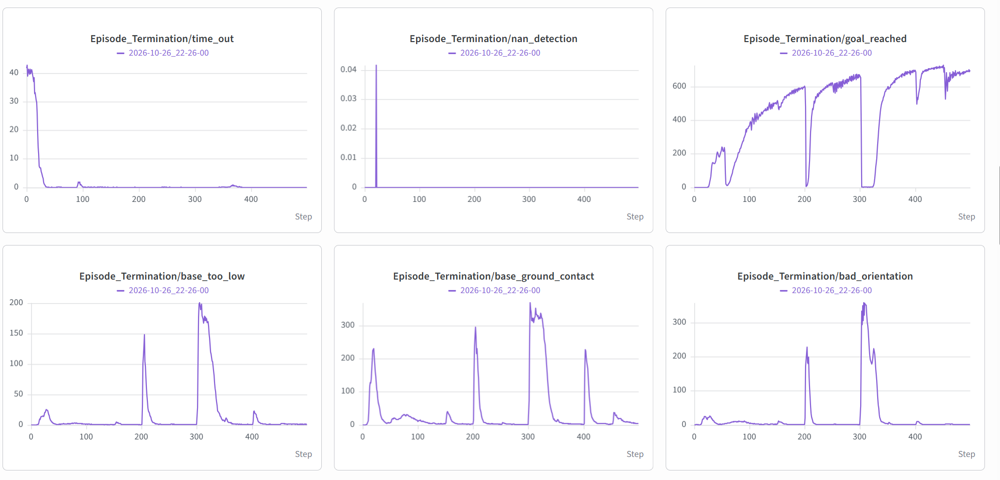<br>**终止原因** | `goal_reached` 终止数一路涨到 ~650/迭代；`time_out` 在 50 迭代后归零；每次升级难度会出现 `base_too_low` / `bad_orientation` 尖峰（摔下去），随后收敛 |
| 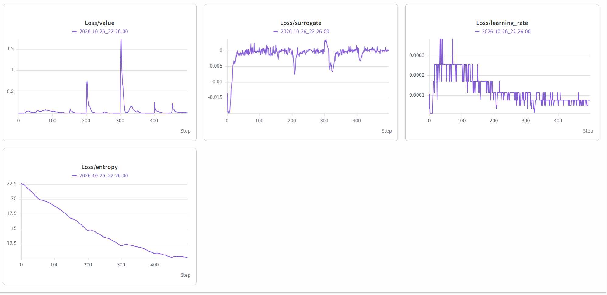<br>**训练损失** | `Loss/value` 平稳（升级时的尖峰是分布变化）；`entropy` 从 22.5 单调降到 11；`learning_rate` 自适应下降 |
| 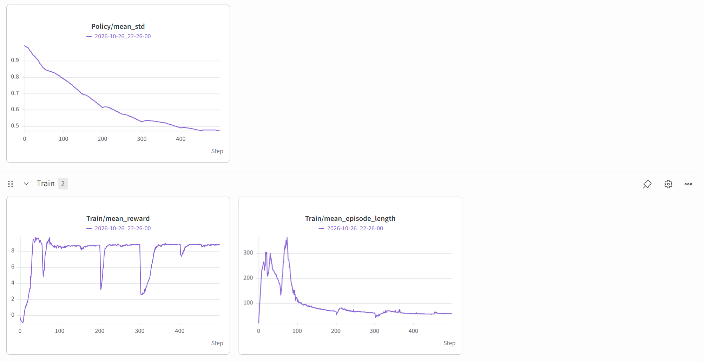<br>**总览** | `mean_reward` 爬到 8.5 后走平；`mean_episode_length` 从 300 步压到 **58 步** —— 回合越来越短，正是"高速冲过去"的直接证据 |

**结论**：策略学会"加速起跳、滞空跨过"，从 play 里能直接看到所有等级都是飞过去。
原因是终点奖励与覆盖率无关、进度奖励无上限、也没有任何"必须被支撑"的约束。

**对应修复（`c64bb45`）**：终点奖励按覆盖率打折、新增 `airborne`（滞空）与 `overspeed`
惩罚、踩桩判定要求真实接触。

---

## 第 2 轮：2026-10-27_07-56-35（600 迭代）—— 末期趴在桩上磨时间

对应奖励：`c64bb45` **之后**的版本（覆盖率打折 + 滞空/超速惩罚）。

前 540 迭代表现很好：`stone_coverage` 从 0 爬到 **0.85**（比上一轮 0.43 明显改善），
但 **在 ~545 迭代出现行为切换**：

| 曲线 | 现象 |
| --- | --- |
| 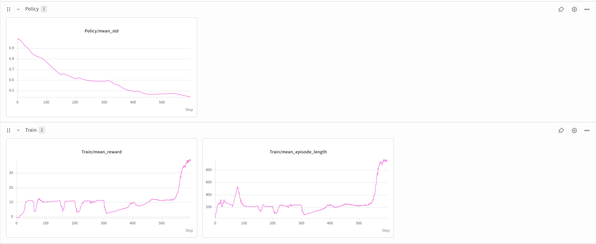<br>**总览** | `mean_reward` 反而**从 10 涨到 37**，`mean_episode_length` 从 200 涨到 **900 步（= 20 s 超时）** |
| 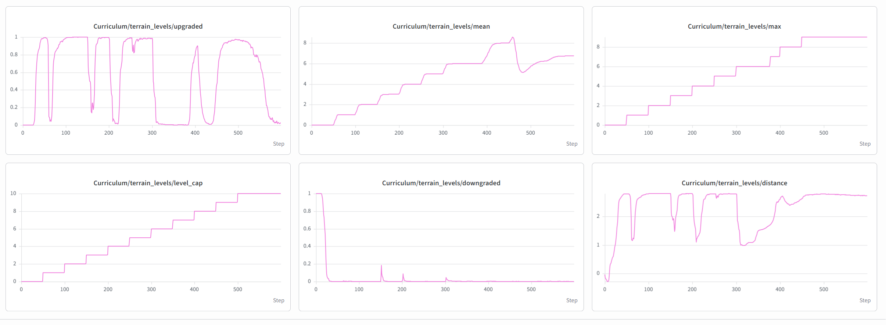<br>**地形课程** | `upgraded` 从 0.95 **掉到 0.05**，`distance` 停在 2.8 以下——不再跨到最后一块平台 |
| 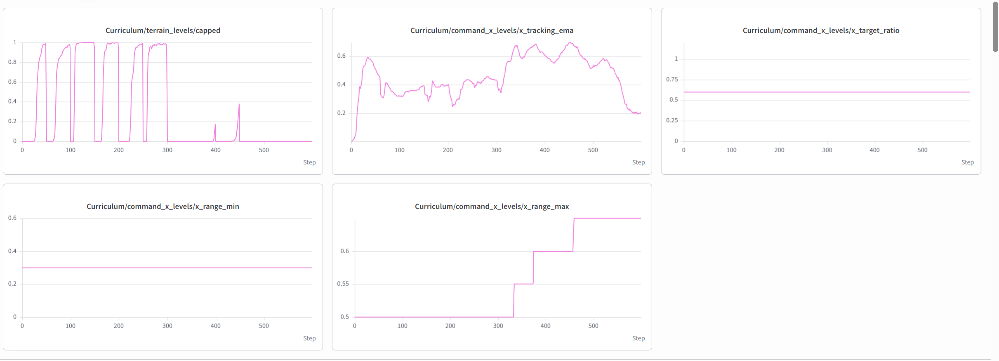<br>**速度课程** | `x_tracking_ema` 从 0.6 **掉到 0.2**（走得太慢，跟不上指令） |
| 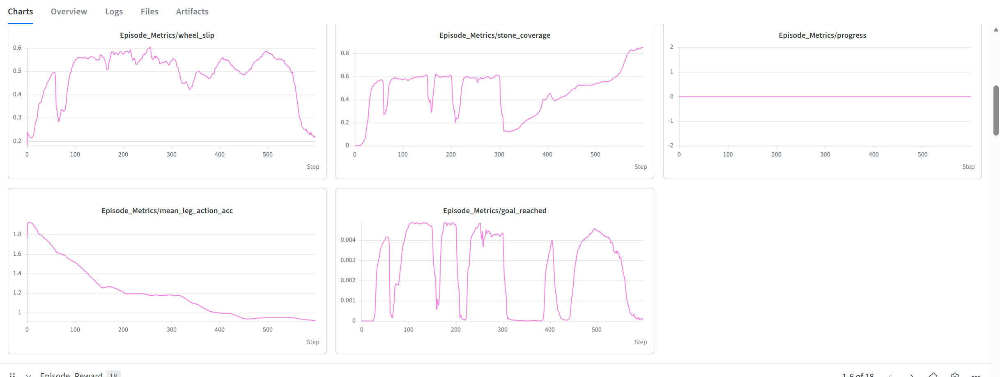<br>**任务指标** | `stone_coverage` 涨到 0.85（桩都摸到了），但 `goal_reached` **归零** |
| 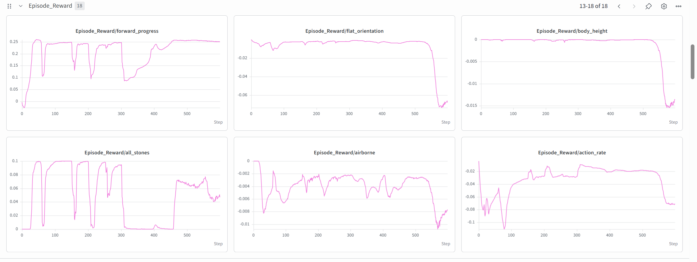<br>**奖励项** | `flat_orientation`、`body_height`、`action_rate`、`airborne` 同时恶化——姿态与动作都变差 |
| 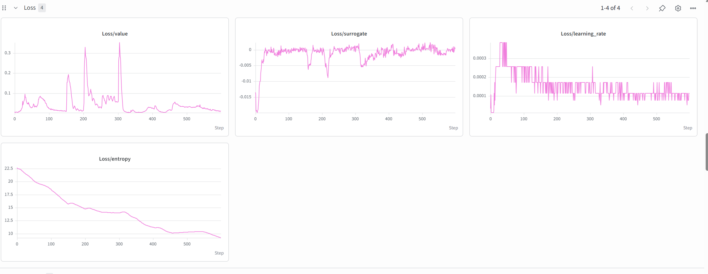<br>**训练损失** | 价值损失、替代损失、熵、学习率都正常下降——**不是 PPO 崩了，是奖励结构被绕过了** |

**结论：奖励涨了，任务反而崩了。** 策略发现了一个更划算的局部最优：

```text
在桩上慢慢蹭，把 16 根桩都摸一遍（+5 × 16 = 80）+ 踩满奖励（+20）
→ 然后原地耗到 20 s 超时（超时没有任何惩罚）
对比：冲过终点只有 60 × (0.2 + 0.8 × coverage) ≈ 53
```

所以它停在最后一根桩前，既不摔也不过——`upgraded` 归零、回合长度顶到超时上限。

这一轮录两段视频做对照：

| 阶段 | 对应 checkpoint | 视频 | 状态 |
| --- | --- | --- | --- |
| 500 迭代（行为切换前） | `model_500.pt` | [stepstone_demo_500.mp4](../assets/videos/2026-10-27_07-56-35/stepstone_demo_500.mp4) | ✅ 已完成 |
| 600 迭代（切换后） | `model_600.pt` | [stepstone_demo_600.mp4](../assets/videos/2026-10-27_07-56-35/stepstone_demo_600.mp4) | ✅ 已完成（原文件名 `趴在桩上睡大觉.mp4`） |

> 500 迭代的录像里能看到一个**地形缺陷**：最难等级的起点平台到第一根桩的净空被
> `stagger` 推到 0.45 m（第二列），加上 10% 缺桩，机器人经常够不到第一根桩、直接掉坑。
> 已在 `b31d933` 修复：进出两个边排固定不加错位、也不允许缺桩，实测各等级首桩净空
> 都回到 5–15 cm。

**对应修复（`6843e16`）**：

| 项 | 旧 | 新 |
| --- | --- | --- |
| `goal_reached` | 60 | **120** |
| `time_out` | 无惩罚 | **−20** |
| `stone_touch` | 5 | **2** |
| `all_stones` | 20 | 20（不变） |

即"摸桩"不再比"过终点"值钱，磨时间也不再免费。

---

## 第 3 轮：2026-10-28_10-23-47（800 迭代，20480 并行）—— 首次稳定通过

奖励版本：`efc378c`（单桩交错 zigzag、`max_step=0.46`、终点 120 / 超时按距离缩放 /
摔倒 -10 / 踩桩 +2），地形 8 m × 1.6 m、回合 30 s。

| 曲线 | 现象 |
| --- | --- |
| 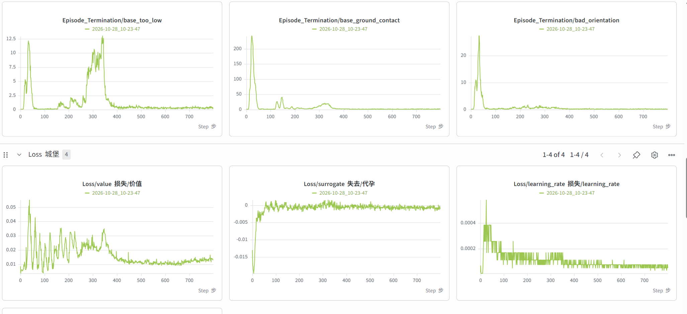<br>**终止** | `base_ground_contact` / `bad_orientation` 在 30 迭代后归零；`base_too_low` 在 300–370 有一波（课程推到 5–6 级的适应期），**380 迭代后接近 0** —— 不再摔了 |
| 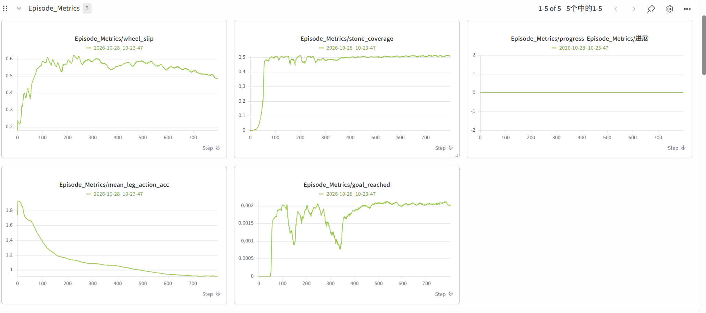<br>**任务指标** | `stone_coverage` 60 迭代就到 **0.50** 并保持；`mean_leg_action_acc` 1.9 → 0.9（动作变平滑）；`wheel_slip` 200 迭代见顶 0.6，之后缓慢降到 0.5 |
| 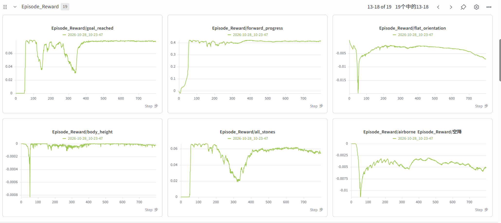<br>**奖励项** | `goal_reached` 稳定 0.06、`forward_progress` 0.4；但 **`flat_orientation` 从 −0.004（500 迭代）掉到 −0.007（800）**，`airborne` 也从 −0.005 变到 −0.006 |
| 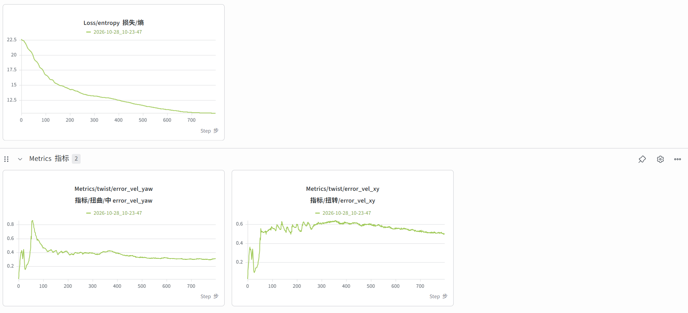<br>**损失与跟踪** | `entropy` 22.5 → 10（探索基本停）；`error_vel_xy` 稳定 0.5、`error_vel_yaw` 0.28 |

**结论**：这一轮第一次做到了“稳定通过”——终止项归零、`goal_reached` 平台稳定，
`distance` 稳定在 6.7/6.8 m。但 **500 迭代之后姿态项开始变差**（`flat_orientation`
负得更多、`airborne` 更多），play 里表现为**点头撅屁股式的前后摇晃**：

- 600–700 迭代是姿态和通过率的最佳平衡点；
- 700 迭代之后 `entropy` 已经压到 10、`mean_leg_action_acc` 不再下降，策略只能靠
  “加大动作幅度”去追剩下的那点奖励 —— 也就是用户看到的晃。
- 复盘建议：把 `--agent.max-iterations` 设到 **650**，或者用 `model_650.pt` 作为
  最终交付；继续加迭代只会放大摇晃。

| checkpoint | 视频 |
| --- | --- |
| 500 迭代 | [stepstone_500it.mp4](../assets/videos/2026-10-28_10-23-47/stepstone_500it.mp4)（28 MB） |
| 800 迭代 | [stepstone_800it.mp4](../assets/videos/2026-10-28_10-23-47/stepstone_800it.mp4)（11 MB） |

> **`stone_coverage` 恒为 0.50 的原因（已查清，不是统计 bug）**：这一轮跑的还是
> **两条平行桩列**的地形（`f18cf50` 之前）。覆盖率按“该 patch 全部桩”做分母，
> 而策略整段都走在**同一条桩列**上，另一条列一根都没踩到 —— 正好 50%。
> 单环境脚本 `tools/check_stepstone_coverage.py` 逐根瞬移验证是 1.00，说明统计本身正确。
> 视觉上“每根都踩到了”是因为两条列在俯视下交错，跟踪的那一条确实每根都压到了。
>
> 这项在这里是**硬指标**（规则要求每根桩都被足底接触至少一次），所以 0.50 意味着
> 旧地形下这个策略**并不合规**。`efc378c` 改成单桩交错后，所有桩都在行进路线上，
> 覆盖率应自然逼近 1.0；下一轮训练重点看这一条能否 ≥0.9。

## 复现与回放

```bash
# 按难度回放某一轮的 checkpoint（每个环境一个等级）
uv run python tools/play_stepstone_levels.py \
  --checkpoint-file logs/rsl_rl/robot_stepstone/2026-10-27_07-56-35/model_600.pt

# 只看最高难度
uv run python tools/play_stepstone_levels.py --checkpoint-file <ckpt> --levels 9

# 内置 play（随机分布到 0..9 级，同等级的环境会叠在一个出生点）
STEPSTONE_PLAY_MAX_LEVEL=9 uv run play Robot-StepStone-v0 --checkpoint-file <ckpt> --num-envs 10
```

## 记录模板

新增一次训练时：截图放 `assets/images/<启动时间>/`、视频放 `assets/videos/<启动时间>/`，
在本文的表格里加一行，并写清"这次是哪一版奖励、出现了什么行为、对应哪次修复"。
