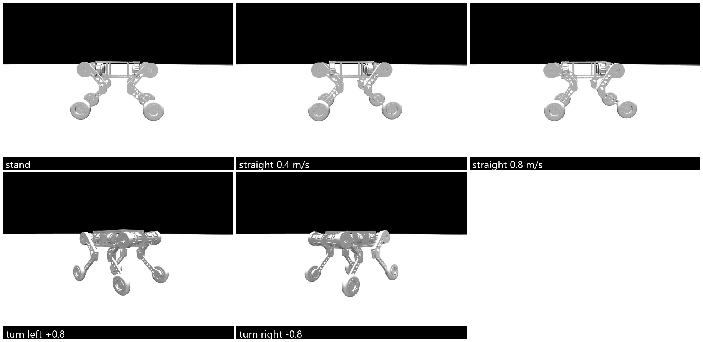

# 16DOF 轮足狗：平地直行 + 锁轮步态转向

在 **MuJoCo + mjlab** 中训练一台 16 自由度轮足机器狗，并满足三个硬约束：

1. **上电初始站姿是 45° 蹲姿**：`base_link` 离地 33.64 cm，四条腿 `thigh ±45°`、`calf ∓90°`、`hip 0°`；
2. **直行纯轮驱**：直行时四条腿保持 45° 站姿、不迈步，只靠四个轮子前进；
3. **转向锁轮步态**：转向时轮电机目标为 0（允许轮子被动滚），用抬腿步态完成原地转向。

最终交付是一个**混合控制器**，而不是单个端到端策略：

```text
                  指令 (vx, vy, wz)
                          │
              ┌───────────┴───────────┐
        abs(wz) < 0.1            abs(wz) ≥ 0.1
              │                       │
   腿：零动作，PD 保持 45°      腿：锁轮步态策略
   轮：vx / R × 1.14            轮：动作目标 0
```



> 上图是早期浅色地面录制的混合策略拼图；最新的原生查看器已经换成黑底白线网格。
> 完整训练过程和踩坑记录见 [`docs/训练记录.md`](docs/训练记录.md)。

---

## 项目状态

| 项目 | 状态 |
|---|---|
| 45° 初始站姿门禁 | ✅ 已通过（零动作 4 s，base 0.3208 m，0 自碰撞） |
| 直行 0.2 / 0.4 / 0.8 m/s | ✅ 已通过（轮驱，腿不迈步） |
| 原地左转 / 右转 ±0.8 rad/s | ✅ 已通过（锁轮步态） |
| 直行 ↔ 转向硬切换 | ✅ 仿真 20 s，0 摔倒 |
| 原生 MuJoCo 实时查看器 | ✅ 已完成（`tools/view_hybrid.py`） |
| 实机验证 | ⏳ 未做；目前只有 MuJoCo 仿真结果 |
| 最终版弧线转向 / 横移 | ⏳ 未纳入最终交付；旧步态策略可做弧线，作为对照保留 |

当前结论：**仿真里能稳定站、直行和原地转向**。实机前还需要做轮滑系数、PD 增益、通信延迟和 IMU 噪声的标定。

---

## 0. 下载即跑（拿到仓库后最短路径）

仓库自带训练好的模型（`checkpoints/`），**不需要重新训练**：

```powershell
git clone -b beifen --depth 1 https://github.com/JinHao0007/16DOF-WheelLeg-RL.git
cd 16DOF-WheelLeg-RL\站立行走转弯\mxz

# 一次性装环境（细节见 1.1）
py -3.11 -m venv .venv
.\.venv\Scripts\Activate.ps1
pip install torch==2.11.0 --index-url https://download.pytorch.org/whl/cu128
pip install -r requirements.txt

.\run_view.ps1       # 45° 站姿，不需要任何 checkpoint
.\run_hybrid.ps1     # 混合控制器演示：站立 → 直行 → 锁轮转向（推荐）
```

`run_*.ps1` 会自动找 Python（`$env:PYTHON` → 工程内 `.venv` → PATH），找不到会给出三种补法。

> 需要 NVIDIA GPU（mjlab 跑在 MuJoCo Warp/CUDA 上）；RTX 5060 Laptop 8 GB 已验证。

---

## 1. 快速开始

### 1.1 环境

已验证环境：

| 组件 | 版本 |
|---|---|
| 系统 | Windows 10/11 |
| Python | 3.11.5 |
| PyTorch | 2.11.0 + CUDA 12.8 |
| MuJoCo | 3.8.1 |
| mjlab | 1.4.0（PyPI 包；任务由本仓库自己注册） |
| RSL-RL | rsl-rl-lib 5.4.0 |
| GPU | NVIDIA RTX 5060 Laptop 8 GB |

从零装环境（venv 建在工程根目录，`run_*.ps1` 会自动使用它）：

```powershell
py -3.11 -m venv .venv
.\.venv\Scripts\Activate.ps1

# 1) CUDA 版 torch（不要用默认 PyPI 的 CPU 包）
pip install torch==2.11.0 --index-url https://download.pytorch.org/whl/cu128

# 2) mjlab + rsl-rl；mujoco / mujoco-warp / viser / tyro 由 mjlab 带出
pip install -r requirements.txt
```

装完自检：

```powershell
python -c "import mjlab, torch, mujoco; print(mjlab.__version__, torch.__version__, mujoco.__version__)"
# 期望输出：1.4.0 2.11.0+cu128 3.8.1
```

> 换机器时只有 torch 的 index-url 需要跟着 CUDA 版本改（cu121 / cu124 / cu128），
> mjlab 与 rsl-rl 版本保持不变，策略才能和训练时一致。
> 工程**不需要** `pip install -e .`：启动脚本会设 `PYTHONPATH=src` 并显式 `import robot` 注册任务。

### 1.2 三种启动方式

**A. 一键脚本（推荐）**：自动找 Python、自动设 `PYTHONPATH`：

```powershell
.\run_view.ps1       # 45° 站姿，无策略
.\run_hybrid.ps1     # 混合控制器实时演示
.\run_play.ps1       # mjlab play 入口，原生窗口回放
.\run_eval.ps1       # 固定指令定量评估
.\run_train.ps1      # 训练
```

**B. 激活 venv 后直接调 Python**（参数完全等价）：

```powershell
.\.venv\Scripts\Activate.ps1
$env:PYTHONPATH = "$PWD\src"
$env:PYTHONIOENCODING = "utf-8"
python tools\view_hybrid.py
```

**C. 指定解释器**：先 `$env:PYTHON = "C:\Python311\python.exe"`，再跑 A 里的脚本。

> `PYTHONPATH` 的作用：让本工程的 `robot` 包优先于别处同名的包；
> `run_*.ps1` 已处理好，不需要手动重复设置。

### 1.3 直接看效果（不训练）

仓库自带 `checkpoints/model_1795.pt`（锁轮转向，最终交付），不训练即可演示：

```powershell
.\run_hybrid.ps1
```

等价写法：激活 venv 后 `python tools\view_hybrid.py`。

会打开 **MuJoCo 原生 `mjlab scene` 窗口**，1 个机器人，自动循环：

```text
站立 2 s → 直行 0.4（4 s）→ 左转 +0.8（3 s）
→ 直行 0.8（4 s）→ 右转 −0.8（3 s）→ 重复
```

窗口获得焦点后可用键盘接管：

| 按键 | 作用 |
|---|---|
| `W` / `S` | vx +/− 0.1 m/s（直行模式） |
| `A` / `D` | wz +/− 0.2 rad/s（转向模式） |
| `X` | 停止，回站立 |
| `R` | 恢复自动循环 |

启动时加 `--manual` 可一进来就用键盘：

```powershell
.\run_hybrid.ps1 --manual
```

> 终端只是启动器，**关闭终端会杀掉查看器**；退出请关 MuJoCo 窗口或回终端按 `Ctrl+C`。

另一条路径：`.\run_play.ps1` 走 mjlab 自带的 play 入口（同样自带锁轮 checkpoint，默认原生窗口）。
`--viewer viser` 可换成 `http://localhost:8080` 的网页，但 mjlab 1.4.0 的 viser 摇杆 GUI 在指令范围含 0 的任务（站姿/直行/锁轮）上会抛 `AssertionError`，所以一键脚本默认用原生窗口。

### 1.4 定量评估

```powershell
.\run_eval.ps1                                # 锁轮策略，全部场景
.\run_eval.ps1 --scenario stand              # 只跑站姿
.\run_eval.ps1 -Checkpoint checkpoints\model_1396.pt
```

混合控制器（腿/轮混合逻辑，最接近最终交付）：

```powershell
python tools\eval_hybrid.py --num-envs 16 --steps 1000
```

两者默认都读 `checkpoints/model_1795.pt`，可用 `--locked-checkpoint` / `-Checkpoint` 换模型。
`--steps 1000` 在 50 Hz 下就是 20 s；前面有 50 步 settle，不纳入统计。

### 1.5 重新训练锁轮转向策略（可选）

最终交付只依赖锁轮策略；直行不需要训练。下面是一条从零训练的命令示例：

```powershell
.\run_train.ps1 Robot-WalkTurn-Locked-v0 `
  --env.scene.num-envs 2048 `
  --agent.max-iterations 1800 `
  --agent.run-name locked_repro
```

> 训练日志在 `logs/rsl_rl/robot_walk_turn_locked/`，每 100 轮保存一个 `model_*.pt`。
> 最终使用的 `locked_v1` 训练了 1795 轮。

### 1.6 Git Bash

Git Bash 不能直接跑 `.ps1`，激活 venv 后直接调用 Python 入口即可：

```bash
cd /path/to/16DOF-WheelLeg-RL/站立行走转弯/mxz
source .venv/Scripts/activate

export PYTHONPATH="$PWD/src"
export PYTHONIOENCODING=utf-8

python tools/view_hybrid.py
python tools/eval_hybrid.py --num-envs 16 --steps 1000
```

> Git Bash 里路径用正斜杠 `/`，反斜杠会被当成转义符。
> 默认 checkpoint 是 `checkpoints/model_1795.pt`，不用手写长路径。

---

## 2. 最终结果

混合控制器在 **16 个并行环境、每个 1000 步（20 s）** 下的统计：

| 场景 | 指令 vx / wz | 实际 vx / wz | 误差 | base z (m) | 腿 abs(v) (rad/s) | 轮 abs(v) (rad/s) | 终止 |
|---|---|---|---|---|---|---|---|
| 零命令站立 | 0 / 0 | −0.001 / −0.001 | 0.001 | 0.324 | 0.017 | 0.02 | 0 |
| 直行 0.2 | 0.2 / 0 | 0.205 / 0.000 | 0.005 | 0.329 | 0.007 | 2.45 | 0 |
| 直行 0.4 | 0.4 / 0 | 0.411 / −0.000 | 0.011 | 0.329 | 0.005 | 4.92 | 0 |
| 直行 0.8 | 0.8 / 0 | 0.823 / 0.001 | 0.023 | 0.326 | 0.017 | 9.86 | 0 |
| 原地左转 | 0 / +0.8 | −0.022 / +0.790 | 0.020 | 0.343 | 0.560 | 0.76 | 0 |
| 原地右转 | 0 / −0.8 | +0.017 / −0.785 | 0.019 | 0.340 | 0.564 | 0.87 | 0 |
| 直行 → 左转 → 直行 | 硬切换 | — | — | 0.336 [0.322, 0.357] | — | — | 0 |

读表要点：

- **直行时腿几乎不动**：腿关节平均绝对速度只有 0.005–0.017 rad/s，前进完全由轮子完成。
- **转向时轮子只是被动滚**：轮动作目标为 0，轮子被地面带动约 0.76–0.87 rad/s；转向由步态完成。
- **高度稳定**：站立 0.324 m、直行 0.326–0.329 m、转向 0.340–0.343 m，都在 0.31–0.35 m 目标带内。
- **20 s 零摔倒**，直行↔转向硬切换也没有触发终止。

演示视频在 [`docs/videos/`](docs/videos/)：

| 文件 | 内容 |
|---|---|
| `hybrid_stand-step-0.mp4` | 零命令站立 |
| `hybrid_straight_0.4-step-500.mp4` | 直行 0.4 m/s |
| `hybrid_straight_0.8-step-1000.mp4` | 直行 0.8 m/s |
| `hybrid_turn_left-step-1500.mp4` | 原地左转 |
| `hybrid_turn_right-step-2000.mp4` | 原地右转 |

---

## 3. 技术方案

### 3.1 为什么用混合控制器

**直行**：如果让 12 个腿关节也参与直行，策略很容易学成“小碎步 + 轮子”的混合步态，速度跟踪不一定差，但腿会持续摆动、能耗高，也不符合“上电 45° 站姿保持”的要求。

直行时直接把腿动作置零，45° 由关节 PD 保持；轮子按 `vx / R × 1.14` 给速度目标。这里的 `1.14` 是仿真里实测的轮滑前馈系数，不是物理常数，换地面/负载要重新标定。

**转向**：只靠四个轮子差速原地转向，在旧工程里实测只能转出指令的约 4%，因为轮子接近横向摩擦临界，继续加大轮速只会打滑。因此转向必须抬腿迈步；同时把轮电机目标锁为 0，避免轮子和腿“抢地面”。

**模式选择**：`abs(wz) < 0.1` 走直行，否则走锁轮步态。这个阈值很小，实际使用中只区分“纯直行”和“有转向意图”。

### 3.2 45° 站姿与模型修正

实机标定：

| 部位 | 角度 |
|---|---|
| 前腿 FR / FL：hip | 0° |
| 前腿 FR / FL：thigh | +45° |
| 前腿 FR / FL：calf | −90° |
| 后腿 RL / RR：hip | 0° |
| 后腿 RL / RR：thigh | −45° |
| 后腿 RL / RR：calf | +90° |

对应 `src/robot/naming.py` 的 `STAND_JOINT_POS`；`base_link` 初始高度 `0.3362 m`，模型顶部 `0.4824 m`。

原始 MJCF 在这个 45° 站姿下有 **7 处 `thigh_Link ↔ base` 自碰撞**，穿透 3.2–3.4 cm，机器人会被顶到 z≈0.23 m，怎么都站不到 0.336 m。`src/robot/robot_cfg.py` 做了两个只改碰撞体、不改关节/惯量的修正：

- 机身碰撞盒 y 半宽 `0.1384 → 0.125 m`；
- 四条大腿的碰撞圆柱沿 y 向外移 `0.035 m`。

修正后 45° 站姿 0 自碰撞，零动作 PD 稳定在 `0.3208 m`，所以高度奖励目标取 `0.320 m`（PD 稳态会下沉约 1.5 cm）。

### 3.3 观测与动作

| 项目 | 内容 |
|---|---|
| 控制频率 | 50 Hz（仿真 `dt=0.005`，`decimation=4`） |
| episode | 20 s |
| actor 观测 | 53 维 |
| critic 观测 | 60 维 |
| 动作 | 16 维 = 12 腿位置 + 4 轮速度 |

actor 的 53 维：

```text
base_ang_vel 3 + projected_gravity 3 + command 3
+ joint_pos 12 + joint_vel 12 + wheel_vel 4 + last_action 16 = 53
```

critic 额外看：

```text
base_lin_vel 3 + foot_contact 4 = +7 → 60
```

- actor 只用本体感知，部署时不需要外部动捕/视觉；
- critic 的特权信息只用于训练，不进入 actor；
- 关节位置/速度、轮速都加观测噪声，提高鲁棒性。

动作层：

- 12 个腿关节是**位置目标**，默认偏移就是 45° 站姿；缩放 `0.25 rad`，hip 减半为 `0.125 rad`；
- 4 个轮子是**速度目标**，缩放 `10 rad/s`；
- 腿动作低通 5 Hz、轮动作低通 15 Hz，并随机延迟 0–2 个控制步；
- 锁轮阶段把轮动作 scale 设为 `0`，策略仍输出 16 维，但轮电机目标恒为 0。

### 3.4 奖励设计

奖励按阶段组合，核心目标不是“走得快”，而是**先站住、再直行、最后转向**：

| 目标 | 关键奖励项 | 说明 |
|---|---|---|
| 速度跟踪 | `track_lin_vel_x`、`track_lin_vel_y`、`track_ang_vel_z` | 直行/转向的主奖励 |
| 高度 | `base_height_l2` | 目标 0.320 m；权重 −20（直行）、−30（站立）、−40（转向） |
| 姿态 | `joint_deviation_l2`、`joint_pos_penalty` | 站立贴 45°；行走时限制腿偏离默认姿态 |
| 稳定 | `upright`、`flat_orientation`、`lin_vel_z`、`body_ang_vel` | 防翻、防上下跳、防机身乱转 |
| 接触/步态 | `wheel_contact`、`feet_air_time`、`wheel_roll_tracking` | 轮子着地、抬腿节拍、轮速前馈 |
| 防漂移 | `lin_vel_y_l2`、`stand_still_xy_l2` | 转向阶段压横向漂移；零指令时压 base 水平速度 |
| 平滑/能耗 | `action_rate`、`joint_acc`、`joint_torques` | 减少抖动和电流冲击 |
| 安全 | `body_collision`、`is_terminated` | 机身/腿撞地、翻倒直接终止并重罚 |

几个调参教训（详细数据见训练记录）：

- `base_height_l2` 权重太弱时，策略会把腿伸直站到 0.47 m；必须给到 −20 以上。
- 转向阶段 `track_lin_vel_y` 权重太低会出现明显横向漂移；最终加到 1.5，并叠加 `lin_vel_y_l2 = −4`。
- 右转从直行策略热启动会卡在“负 wz 就站着”的局部最优；最终锁轮策略从零训练。
- `joint_pos_penalty` 曾试过 −100，奖励直接崩掉；最终用 −5 的量级。

### 3.5 指令采样

`src/robot/mdp/commands.py` 没有用均匀采样，而是按模式采样，避免大量“斜着走 + 边转边走”的混合样本：

| 模式 | 典型占比 | 指令 |
|---|---|---|
| 直行 | 15%–45% | vx 有值，vy = wz = 0 |
| 原地转向 | 45%–100% | vx = vy = 0，abs(wz) ≥ 0.3 |
| 弧线 | 30% | vx ≥ 0.2，wz ≠ 0 |
| 横移 | 10% | vy 有值，vx = wz = 0 |
| 站立 | 5%–15% | 全零 |

最终锁轮任务只保留**原地转向 + 5% 站立**，wz 在 `[-0.8, 0.8]` 采样；这样策略不用同时学直行和弧线，专注把锁轮转向练稳。

### 3.6 PPO 配置

`src/robot/config/rl_cfg.py`：

| 参数 | 值 |
|---|---|
| actor / critic | 512 → 256 → 128，ELU |
| 学习率 | 8e-4，adaptive |
| gamma / lambda | 0.99 / 0.95 |
| clip | 0.2 |
| entropy | 0.003 |
| epochs / minibatches | 5 / 4 |
| steps per env | 24 |
| 并行环境 | 2048（8 GB 显存约 4.3 GB） |
| 保存间隔 | 100 轮 |

### 3.7 域随机化与终止

训练时加了三类扰动，避免策略只会“记住”一个理想状态：

- 初始位姿/速度小随机：x/y ±0.05 m，yaw ±0.15 rad，vx ±0.1 m/s；
- 每 6–10 s 给机身一个 x/y ±0.2 m/s 的推力；
- 轮子摩擦系数在 0.8–1.2 倍随机（模拟瓷砖/地毯/水泥）。

终止条件：

- 机身倾角超过 1.0 rad；
- 机身碰撞盒触地；
- 出现 NaN；
- 到达 20 s（time-out，不算失败）。

---

## 4. 训练阶段

最终交付只依赖 **D 锁轮转向**和**混合控制器**；A/B/C 是研究过程，用来验证动作空间、奖励和步态，不是运行必需。

| 阶段 | 任务 ID | 规模 | 目的 |
|---|---|---|---|
| A 站姿 | `Robot-WalkTurn-Stand-v0` | 1024 envs × 300 轮 | 45° 站姿站稳、不漂 |
| B 直行 | `Robot-WalkTurn-Straight-v0` | 2048 envs × 1200 轮 | 旧步态版直行速度跟踪 |
| C 转向 | `Robot-WalkTurn-v0` | 2048 envs × 1000+ 轮 | 旧步态版直行/原地/弧线 |
| C2 右转专项 | `Robot-WalkTurn-Right-v0` | 2048 envs | 只练 wz = −0.8，打破右转局部最优 |
| D 锁轮转向 | `Robot-WalkTurn-Locked-v0` | 2048 envs × 1795 轮 | 轮 scale=0，只做原地步态转向 |

训练入口：

```powershell
# 站姿
.\run_train.ps1 Robot-WalkTurn-Stand-v0 `
  --env.scene.num-envs 1024 --agent.max-iterations 300 --agent.run-name stand_smoke2

# 旧步态直行（研究过程）
.\run_train.ps1 Robot-WalkTurn-Straight-v0 `
  --env.scene.num-envs 2048 --agent.max-iterations 1200 --agent.run-name straight_v2

# 锁轮转向（最终交付）
.\run_train.ps1 Robot-WalkTurn-Locked-v0 `
  --env.scene.num-envs 2048 --agent.max-iterations 1800 --agent.run-name locked_repro
```

> `--agent.max-iterations` 在 `--agent.resume True` 时表示**额外**训练轮数，不是总轮数。
> 显存不够就把 `num-envs` 降到 1024；2048 在本机约 1.5–2 s/轮。

---

## 5. 目录结构

```text
16DOF-WheelLeg-WalkTurn_11.27/
├─ 16DOF-URDF/                  # URDF / MJCF / meshes，只读，不改
├─ src/robot/
│  ├─ naming.py                 # 关节名、45° 站姿、轮半径/轮距、PD 增益
│  ├─ robot_cfg.py              # 从 MJCF 组装训练机器人：删 floor/actuator、自碰撞修正
│  ├─ config/env_cfgs.py        # 观测/动作/奖励/终止/课程/地面
│  ├─ config/rl_cfg.py          # PPO 超参
│  └─ mdp/
│     ├─ commands.py            # 直行/原地/弧线/横移/站立 指令采样
│     ├─ rewards.py             # 自定义奖励项
│     └─ lowpass_actions.py     # 腿位置/轮速度低通 + 随机延迟
├─ scripts/
│  ├─ train.py                  # 训练入口
│  └─ play.py                   # viser 网页回放
├─ tools/
│  ├─ view_hybrid.py            # 原生 MuJoCo 实时查看器（最终推荐）
│  ├─ eval_hybrid.py            # 混合控制器定量评估/录像
│  ├─ eval_policy.py            # 单策略评估
│  ├─ check_stand.py            # 45° 站姿门禁
│  ├─ check_env.py              # 环境体检
│  ├─ probe_hybrid.py           # 混合控制器探针
│  └─ find_python.ps1           # 启动脚本共用的 Python 解释器查找
├─ docs/
│  ├─ 训练记录.md               # 逐轮实验、失败原因、验收数据
│  ├─ images/                   # 拼图/截图
│  └─ videos/                   # 评估录像
├─ checkpoints/                 # 训练好的模型，随仓库分发（不用重训）
│  ├─ model_1795.pt             # 最终：锁轮步态转向
│  ├─ model_299.pt              # 站姿
│  └─ model_1396.pt             # 旧步态转向（对照）
├─ logs/rsl_rl/                 # 自己训练时的日志与 checkpoint（不入库）
├─ requirements.txt             # 依赖与实测版本
├─ run_hybrid.ps1               # 一键混合控制器演示（自带模型）
├─ run_train.ps1                # 一键训练（自动设 PYTHONPATH）
├─ run_eval.ps1                 # 一键定量评估
├─ run_view.ps1                 # 一键看 45° 站姿
└─ run_play.ps1                 # 一键 viser 回放
```

改代码时优先看这三个文件：

- 换模型/关节名/站姿：`src/robot/naming.py`、`src/robot/robot_cfg.py`；
- 改任务/奖励/指令：`src/robot/config/env_cfgs.py`；
- 改混合控制/查看器：`tools/eval_hybrid.py`、`tools/view_hybrid.py`。

---

## 6. 最终 checkpoint

| 用途 | 路径 |
|---|---|
| 直行腿姿（45° 保持） | 零动作 + PD，不需要 checkpoint |
| 站姿训练（仅站姿阶段） | `checkpoints/model_299.pt` |
| 锁轮步态转向（最终交付） | `checkpoints/model_1795.pt` |
| 旧步态版（对照） | `checkpoints/model_1396.pt` |

三个模型都随仓库分发（每个约 4.5 MB），下载即可复现，不需要重新训练。
它们原始的训练目录分别在 `logs/rsl_rl/robot_walk_turn_stand/...`、
`logs/rsl_rl/robot_walk_turn_locked/...`、`logs/rsl_rl/robot_walk_turn/...`，
那些目录**不随仓库分发**，只在你自己训练时才会重新出现。

混合控制逻辑在 `tools/eval_hybrid.py`：

- `abs(wz) < 0.1`：腿动作全 0，轮目标 `(vx / 0.0839) × 1.14 / 10`；
- 否则：调用 `model_1795.pt`，轮动作强制 0。

`stand_smoke2/model_299.pt` 只用于站姿阶段验证，**直行不加载它**。

---

## 7. 实时查看器

```powershell
.\run_hybrid.ps1
```

- 1 个环境，原生 `NativeMujocoViewer`，不是 mp4，也不是 viser 网页；
- 自动循环站立 → 直行 0.4 → 左转 → 直行 0.8 → 右转；
- 默认相机：`distance=3.0`、`elevation=-18`、`azimuth=135`、`lookat=(0, 0, 0.24)`；
- 地面是黑底白线 1 m 网格，定义在 `src/robot/config/env_cfgs.py` 的 `_GROUND_GRID_TEXTURE/_GROUND_GRID_MATERIAL`。

### 常见显示问题

**模型看起来被“切开/不完整”**：鼠标滚轮把相机拉得太近，近裁剪面切开了腿/轮表面。先向后滚轮拉远，或按 `Backspace` 复位相机；还不行就加大距离：

```powershell
.\run_hybrid.ps1 --distance 3.5
```

**窗口一闪而过 / 没窗口**：确认在正常 Windows 桌面会话运行，而不是无桌面的远程/服务环境；`GLFW library is not initialized` 就是这个原因。

**键盘没反应**：先用鼠标点一下 MuJoCo 窗口，让焦点在查看器上，而不是终端。

---

## 8. 常见问题

| 现象 | 原因 / 解决 |
|---|---|
| `ModuleNotFoundError: No module named 'robot'` | 直接调 `python` 时没设 `PYTHONPATH`；用 `run_*.ps1`，或先 `$env:PYTHONPATH="$PWD\src"` |
| `Python not found` / 找不到解释器 | `run_*.ps1` 支持三种补法：`$env:PYTHON`、工程内 `.venv`、PATH |
| `No checkpoint found` / `找不到锁轮策略 checkpoint` | 仓库自带 `checkpoints/model_1795.pt`；自己训练的用 `--checkpoint-file` / `-Checkpoint` / `--locked-checkpoint` 指定；只看站姿用 `--agent zero` |
| `CUDA out of memory` | 把 `--env.scene.num-envs` 从 2048 降到 1024 |
| 训练一开始就 exit 1，但没有 traceback | 旧工程常见；先看 `logs/rsl_rl/...` 和终端 stderr，确认是不是 CUDA/GLFW 初始化问题 |
| Git Bash 找不到 checkpoint | 路径用 `/`，不要用 `\` |
| `.ps1` 报“字符串缺少终止符” | PowerShell 5.1 按 ANSI 解析 UTF-8 无 BOM 中文；脚本只写 ASCII，中文放 Markdown |
| 查看器里模型被切 | 滚轮拉远 / `Backspace` / `--distance 3.5`，不是模型缺件 |
| `--viewer viser` 报 `AssertionError: max >= value >= min` | mjlab 1.4.0 的 viser 摇杆 GUI 不接受 0 范围（站姿/直行/锁轮任务）；`run_play.ps1` 默认已改用原生窗口，只有全速度范围的 `Robot-WalkTurn-v0` 适合 viser |
| 终端关了查看器也没了 | 终端是启动器；保持终端打开，或改用独立进程启动 |

---

## 9. 已知限制与下一步

**限制**

- 只在 MuJoCo 仿真验证，**没有上实机**；真实电机的摩擦、间隙、延迟、IMU 噪声都会改变结果。
- 直行的 `1.14` 轮滑系数是仿真标定值，换地面/负载需要重新测。
- 最终版只做**原地转向**；弧线转向和横移在旧步态策略里有，但没有纳入最终混合控制器。
- 直行↔转向评估用硬切换（0 摔倒）；实机建议加 0.3–0.5 s 的轮速/步态过渡斜坡，减少冲击。
- 站姿依赖 PD 增益和模型质量；换硬件后要重新做 45° 站姿门禁。

**下一步**

1. 实机标定：轮半径、轮距、轮滑系数、PD 增益、通信延迟；
2. 加 0.3–0.5 s 模式切换斜坡，验证实机冲击；
3. 在锁轮策略基础上加小 vx，做“锁轮弧线转向”；
4. 用真实 IMU/关节编码器噪声做 sim2real 鲁棒性测试。

---

## 10. 参考

- [MuJoCo](https://mujoco.org/)：物理仿真；
- [mjlab](https://github.com/mujocolab/mjlab)：MuJoCo + RL 任务框架；
- RSL-RL：PPO 实现；
- 早期工程（作者本机，**不随本仓库分发**）：提供 venv、训练范式和早期步态策略；
- 模型资产在 `16DOF-URDF/`，版权归原模型作者。

更细的实验数据、失败原因和逐轮记录见 [`docs/训练记录.md`](docs/训练记录.md)。